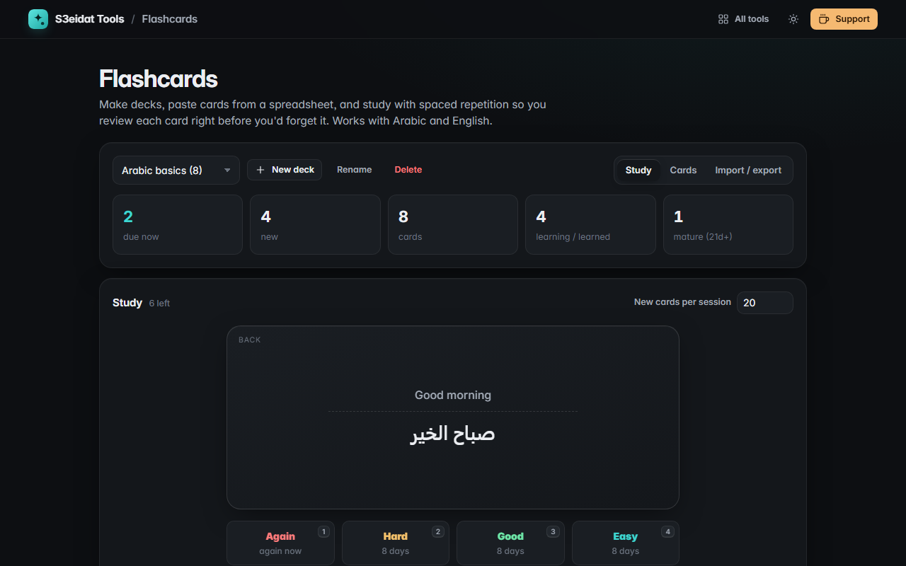

# Flashcards

> Make decks and study them with SM-2 spaced repetition. Free, private, and it runs entirely in your browser.

### ▶ [Open Flashcards](https://s3eidat.github.io/flashcards/)



## Features

- **Decks**: create, rename, delete; cards with a front and back (Arabic and right-to-left text work everywhere)
- **Import** by pasting CSV or TSV straight from Excel or Google Sheets (quoted fields, commas, tabs or semicolons), or open a .csv/.tsv file
- **Study mode** with a flip animation: <kbd>Space</kbd> to flip, <kbd>1</kbd>–<kbd>4</kbd> for Again / Hard / Good / Easy
- **SM-2 spaced repetition**: each button shows when you will see the card next (1 day, 6 days, then interval × ease factor)
- Counts for due, new, learned and mature cards; a limit for new cards per session
- Search and edit cards; **export** a deck as CSV or **back up** all decks with their schedule as JSON (and restore it)

## Privacy

Your decks are saved only in your browser (localStorage). Export a JSON backup to move them to another device. There is no server, no account, no analytics.
The page ships with a strict Content-Security-Policy (`connect-src 'self'`), so the browser
itself blocks any attempt to send data anywhere.

## Run it yourself

It's plain HTML, CSS and JavaScript with no build step:

```bash
git clone https://github.com/s3eidat/flashcards
cd flashcards
python -m http.server 8000
```

Then open http://localhost:8000.

## Support

If this saved you time, **[buy me a coffee ☕](https://s3eidat.github.io/coffee/)**. It keeps every tool free.

---

Part of **[S3eidat Tools](https://s3eidat.github.io/)**: 100+ free, private tools that run in your browser. MIT licensed.
